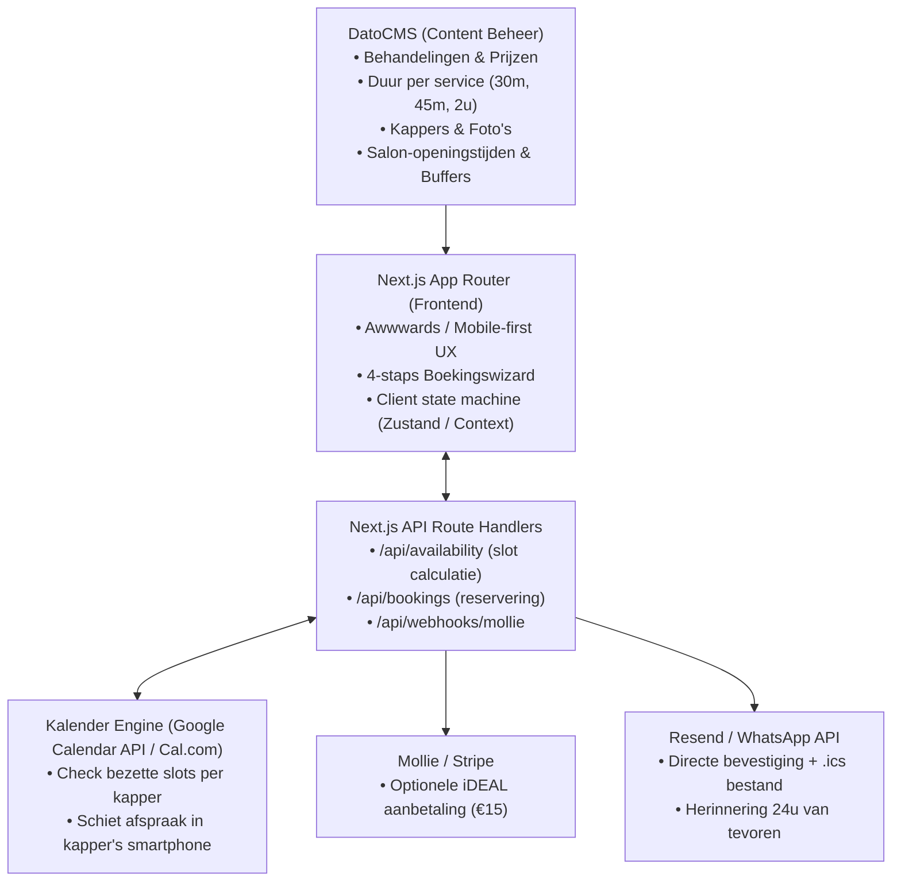

# StudioChair — Headless Salon Booking Engine & Website Platform
*Een product van Studio Maaijen*

> **Doel:** Een 100% commissievrije, high-end afsprakenplanner voor kapsalons en barbershops, naadloos geïntegreerd in een Next.js website met DatoCMS als beheerpaneel en 2-way kalendersync.
> **Projectnaam:** **StudioChair** (`studiochair`)
> **Pay-off:** *"Maximale stoelbezetting, 0% commissie."*
> **Doelgroep:** Kappers en barbershops die nu vastzitten aan Treatwell (35% commissie) of Salonized/Fresha (€40-€100+/mnd + generieke iframe).

---

## 1. Architectuur & Tech Stack



### Stack Specificatie:
* **Frontend:** Next.js 15+ (App Router), TypeScript, Tailwind CSS v4, Framer Motion (vloeiende slide-transities).
* **Content & Salon CMS:** DatoCMS (GraphQL Content Delivery API + Content Management API).
* **Agenda & Sync:** Google Calendar API (OAuth 2-way sync) of headless Cal.com API.
* **Betalingen:** Mollie API (iDEAL, Bancontact, Apple Pay) voor aanbetalingen/no-show borg.
* **E-mail & Meldingen:** Resend met React Email templates + WhatsApp Business Cloud API / Twilio.
* **Validatie:** Zod schemas voor alle inputvelden en API-requests.

---

## 2. DatoCMS Data Schema (Modellen & Velden)

Claude Code dient de volgende TypeScript types en GraphQL queries te implementeren. Voor ontwikkeling zonder live DatoCMS token is een lokale fallback (`data/salon-mock.ts`) verplicht.

### A. Model: `SalonSetting` (Singleton)
| Veldnaam | API Key | Type | Omschrijving |
|---|---|---|---|
| Salon Naam | `name` | Single line string | bijv. *"Atelier Eugène"* |
| Tagline | `tagline` | Single line string | bijv. *"Craftsmanship & Editorial Styling"* |
| Adres & Stad | `address` | Single line string | bijv. *"Ridderkerk, Nederland"* |
| E-mailadres | `email` | Single line string | Contact- en reply-to adres |
| Telefoonnummer | `phone` | Single line string | Direct nummer voor klanten |
| Standaard Buffertijd | `buffer_minutes` | Integer | Schoonmaak/pauze tussen afspraken (default: `10`) |
| No-show Aanbetaling | `deposit_amount_cents` | Integer | Aanbetaling in centen (bijv. `1500` voor €15, `0` = geen aanbetaling) |
| Slot Interval | `slot_interval_minutes` | Integer | Stapgrootte van kalenderrooster (default: `15` of `30`) |

### B. Model: `SalonServiceCategory` (Collectie)
| Veldnaam | API Key | Type | Omschrijving |
|---|---|---|---|
| Categorie Naam | `title` | Single line string | bijv. *"Heren Knippen"*, *"Dames & Styling"*, *"Baard & Care"* |
| Slug | `slug` | Slug | bijv. `heren`, `dames`, `baard` |
| Sorteervolgorde | `sort_order` | Integer | Volgorde in de tab/wizard |

### C. Model: `SalonService` (Collectie)
| Veldnaam | API Key | Type | Omschrijving |
|---|---|---|---|
| Behandeling Naam | `name` | Single line string | bijv. *"Skin Fade & Beard Trim"* |
| Categorie | `category` | Single link | Verwijst naar `SalonServiceCategory` |
| Prijs in centen | `price_cents` | Integer | bijv. `4250` voor €42,50 |
| Tijdsduur (minuten) | `duration_minutes` | Integer | Duur van de behandeling (bijv. `30`, `45`, `120`) |
| Beschrijving | `description` | Text | Korte uitleg van wat er inbegrepen is |
| Populair Badge | `is_popular` | Boolean | Highlight als *"Meest gekozen"* |

### D. Model: `SalonStaff` (Collectie)
| Veldnaam | API Key | Type | Omschrijving |
|---|---|---|---|
| Naam Kapper/Barber | `name` | Single line string | bijv. *"Marcus"*, *"Sophie"* |
| Functie / Specialisme | `role` | Single line string | bijv. *"Senior Stylist & Colorist"* |
| Foto / Avatar | `avatar` | Asset (Image) | Portretfoto voor in de kapper-selectie |
| E-mail | `email` | Single line string | E-mailadres voor agenda-koppeling |
| Google Calendar ID | `calendar_id` | Single line string | Agenda-ID voor real-time beschikbaarheid |
| Actief | `is_active` | Boolean | Tijdelijk uitzetten bij vakantie of ziekte |

---

## 3. De 4-Staps Boekingswizard (UX Blueprint)

De flow moet **100svh mobiel geoptimaliseerd** zijn: grote tik-vlakken, geen priegelige dropdowns, en duidelijke visuele feedback.

```
┌─────────────────────────────────────────────────────────────┐
│  STAP 1: KIES BEHANDELING                                   │
│  [ Heren (3) ]  [ Dames (5) ]  [ Baard & Spa (2) ]          │
│                                                             │
│  ┌───────────────────────────────────────────────────────┐  │
│  │ ○ Skin Fade & Hot Towel             45 min  •  €45,-  │  │
│  │   Inclusief wassen, stylen en nekcontour met mes.     │  │
│  └───────────────────────────────────────────────────────┘  │
│  ┌───────────────────────────────────────────────────────┐  │
│  │ ● Precision Cut (Klassiek)          30 min  •  €35,-  │  │
│  └───────────────────────────────────────────────────────┘  │
├─────────────────────────────────────────────────────────────┤
│  STAP 2: KIES JE KAPPER                                     │
│  ┌───────────────────────┐     ┌───────────────────────┐    │
│  │ [★ Eerste Beschikbaar]│     │ [👤 Marcus]           │    │
│  │ Snelste plek in salon │     │ Master Barber         │    │
│  └───────────────────────┘     └───────────────────────┘    │
├─────────────────────────────────────────────────────────────┤
│  STAP 3: KIES DATUM & TIJDSLOT                              │
│  <  November 2026  >                                        │
│  [Ma 3]  [Di 4]  [Wo 5*]  [Do 6]  [Vr 7]  [Za 8]            │
│                                                             │
│  Ochtend:   [ 09:30 ]  [ 10:15 ]  [ 11:00 ]                 │
│  Middag:    [ 13:30 ]  [ 14:15 ]  [ 15:00 ]  [ 16:30 ]      │
│  Avond:     [ 18:00 ]  [ 18:45 ]                            │
├─────────────────────────────────────────────────────────────┤
│  STAP 4: GEGEVENS & BEVESTIGEN                              │
│  Naam:        [ Eugène Maaijen              ]               │
│  Telefoon:    [ 06 12 34 56 78              ] (voor SMS/WA) │
│  E-mail:      [ eugene@studio-maaijen.nl    ]               │
│  Opmerking:   [ Graag zijkanten op 0.5mm    ] (optioneel)   │
│                                                             │
│  Totaal: €35,- (Aanbetaling: €15,- via iDEAL tegen no-show) │
│  [  BEVESTIG & RESERVEER MIJN STOEL →  ]                    │
└─────────────────────────────────────────────────────────────┘
```

---

## 4. Tijdslot- & Beschikbaarheidsalgoritme (`lib/slots.ts`)

De kern van de afsprakenplanner is het algoritme dat berekent of een kapper vrij is voor een specifieke behandeling.

### Regels voor slotcalculatie:
1. **Behandelduur:** Een slot moet minimaal `duration_minutes + buffer_minutes` aaneengesloten vrij zijn.
2. **Werktijden per Kapper:**
   - Ochtendshift: 09:00 – 13:00
   - Middagshift: 13:30 – 17:30 (30m lunchpauze standaard geblokkeerd)
   - Koopavond (optioneel): 18:00 – 21:00
3. **Bestaande Afspraken Filter:**
   - Haal alle events op van de gekozen kapper voor datum `D`.
   - Elk event genereert een bezet venster: `[event.start, event.end]`.
4. **Collision Check:**
   Een potentiële starttijd $T$ is geldig als en slechts als:
   $$\forall \text{ afspraak } A: (T + \text{duration} + \text{buffer} \le A.\text{start}) \lor (T \ge A.\text{end})$$
   en binnen de werktijden valt.
5. **"Eerste Vrije Kapper" Optie:**
   Indien geselecteerd: voer de slotberekening uit over *alle* actieve kappers en unificeer de beschikbare tijdsloten. Toon bij het tijdslot welke kapper die stoel bemant.

---

## 5. API Route Handlers

### `GET /api/availability`
Query params: `date` (YYYY-MM-DD), `serviceId` (string), `staffId` (optioneel string).
* Haalt service-duur op uit DatoCMS/mock.
* Haalt kalender-busy-windows op via Google Calendar API of interne DB.
* Retourneert JSON met array van beschikbare tijden:
```json
{
  "date": "2026-11-05",
  "serviceDuration": 45,
  "slots": [
    { "time": "09:30", "staffId": "marcus", "staffName": "Marcus" },
    { "time": "10:15", "staffId": "marcus", "staffName": "Marcus" },
    { "time": "11:00", "staffId": "sophie", "staffName": "Sophie" }
  ]
}
```

### `POST /api/bookings`
Body payload:
```json
{
  "serviceId": "skin-fade",
  "staffId": "marcus",
  "date": "2026-11-05",
  "time": "10:15",
  "customer": {
    "name": "Jan Jansen",
    "email": "jan@example.nl",
    "phone": "+31612345678",
    "notes": "Eerste keer bij jullie"
  }
}
```
* Valideert payload met Zod schema.
* Controleert nogmaals of het slot niet zojuist gekaapt is (race-condition lock).
* Indien `deposit_amount_cents > 0`: maakt een Mollie iDEAL betaalverzoek aan en geeft `checkoutUrl` terug.
* Indien geen aanbetaling of na betaling:
  1. Schiet het event in Google Calendar met samenvatting *"Knippen: Jan Jansen (06-12345678)"*.
  2. Verstuurt bevestigingsmail met `.ics` agenda-uitnodiging via Resend.
  3. Retourneert `bookingCode` (bijv. `BK-84920`).

---

## 6. Implementatie Roadmap voor Claude Code

Claude Code dient dit project stapsgewijs in 5 fasen op te zetten:

### Fase 1: Data Models & Mock Engine (Direct Werkend)
* [ ] Maak `types/salon.ts` met interfaces voor `SalonSetting`, `SalonServiceCategory`, `SalonService`, `SalonStaff`, `TimeSlot` en `BookingRequest`.
* [ ] Bouw `data/salon-mock.ts` met realistische barbershop data (4 categorieën, 8 behandelingen, 3 kappers met foto's, openingstijden).
* [ ] Bouw `lib/datocms.ts` met GraphQL query die switcht tussen DatoCMS API en de mock data (resilient fallback).

### Fase 2: De Boekingswizard Component
* [ ] Bouw `components/booking/BookingWizard.tsx` met Framer Motion stap-animaties.
* [ ] Bouw `components/booking/StepService.tsx` (categorie tabs + selecteerbare kaarten).
* [ ] Bouw `components/booking/StepStaff.tsx` (avatar selectie met "Eerste Beschikbare").
* [ ] Bouw `components/booking/StepDateTime.tsx` (horizontale week-kalender + dagdeel tijdsloten).
* [ ] Bouw `components/booking/StepCustomer.tsx` (formulier met Zod-validatie en iDEAL-aanbetalingsindicatie).
* [ ] Bouw `components/booking/BookingConfirmation.tsx` (successcherm met afspraakcode en .ics download).

### Fase 3: Tijdslot-Berekening & API Endpoints
* [ ] Implementeer `lib/slots.ts` met het berekenen van vrije tijdsloten op basis van openingsuren, behandelduur en 10m buffer.
* [ ] Maak `app/api/availability/route.ts` (GET) die slots serveert.
* [ ] Maak `app/api/bookings/route.ts` (POST) die boekingen ontvangt, valideert en bevestigt.

### Fase 4: Integraties (Kalender & Notificaties)
* [ ] Bouw `lib/calendar.ts` voor het genereren van geldige `.ics` iCalendar bestanden.
* [ ] Zet de opzet klaar voor Google Calendar OAuth sync of Cal.com webhook.
* [ ] Bouw de e-mail template voor Resend in `components/emails/BookingConfirmationEmail.tsx`.

### Fase 5: Design Tokens & Thema's (Awwwards Polish)
* [ ] Koppel de styling aan de Studio Maaijen designstijlen bibliotheek:
  - Default thema: **Dark Tech Barber** (`#08090A` achtergrond, `#EDEDEF` tekst, `#5E6AD2` of `#ff5500` accent, League Gothic / Inter).
  - Optioneel thema: **Quiet Luxury / Japandi Salon** (`#F7F6F2` warm zand, `#1C1917` charcoal, serif koppen).
* [ ] Zorg voor 100% WCAG 2.2 AA contrast, zichtbare focus ringen en respect voor `prefers-reduced-motion`.

---

## 7. Verkoop- & Pitch Script (Voor Gesprekken met Kappers)

Wanneer Studio Maaijen dit presenteert aan een salon:

> *"Wij bouwen geen gewone website waar een bezoeker alleen naar kijkt. Wij leveren een compleet digitaal uithangbord met jouw eigen afsprakenplanner erin verwerkt.*
>
> *Drie directe voordelen voor jouw salon:*
> 1. **0% Commissie:** Klanten die via jouw site boeken zijn 100% van jou. Geen 35% afdragen aan Treatwell.
> 2. **Geen no-shows meer:** We kunnen automatisch een aanbetaling van bijv. €15 via iDEAL vragen bij het boeken. Klanten die betalen, komen opdagen.
> 3. **Eenvoud:** Jij beheert zelf prijzen en behandelingen in een overzichtelijke app op je telefoon, en alle afspraken schieten automatisch in jouw eigen Google of Apple Agenda."*
