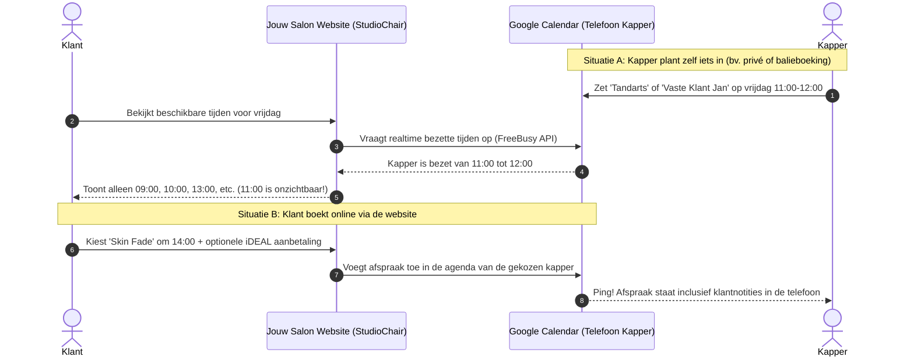

# StudioChair — Handleiding: Teamleden & 2-Weg Google Calendar Koppeling
> **Voor saloneigenaren, barbershops en kappersteams.**  
> *Ontwikkeld door Studio Maaijen (Ridderkerk) — www.studio-maaijen.nl*

---

## 1. Waarom deze oplossing voor jouw salon werkt

Traditionele kassa- en boekingssystemen (zoals Treatwell, Salonized of BarberBooking) dwingen kappers om een aparte, vaak logge app op hun telefoon te installeren. Kappers vergeten daarin te kijken, moeten inloggen en raken gefrustreerd.

**StudioChair pakt dit anders aan:**
* **Geen nieuwe software voor jouw personeel:** Kappers blijven gewoon werken met de **Google Agenda** of **Apple Agenda** die al standaard op hun iPhone of Android-telefoon staat.
* **100% Real-time 2-weg synchronisatie:** 
  1. Een klant boekt online op de website $\rightarrow$ de afspraak verschijnt binnen 2 seconden in de agenda van de juiste kapper.
  2. De kapper zet een tandartsafspraak, lunch of privétijd in zijn/haar telefoon $\rightarrow$ dat tijdstip is op de website **per direct niet meer boekbaar**.
* **Geen dubbele boekingen:** Nooit meer twee klanten tegelijk op één stoel.
* **Jouw klantdata blijft van jou:** In tegenstelling tot Treatwell (die jouw klanten aanbiedingen van concurrerende salons stuurt), blijft alle data 100% eigendom van jouw salon.

---

## 2. Visueel overzicht: Hoe de synchronisatie werkt

---

## 3. Voor de Saloneigenaar: Medewerkers beheren in DatoCMS

Als saloneigenaar heb je toegang tot het gebruiksvriendelijke **DatoCMS dashboard**. Een nieuwe collega toevoegen of het rooster aanpassen kost minder dan 1 minuut:

### Een collega toevoegen (Stappenplan):
1. Log in op jouw DatoCMS beheeromgeving.
2. Ga in het menu naar **`Medewerkers` (SalonStaff)** en klik op **`Nieuw Record`**.
3. Vul de volgende velden in:
   * **Naam:** Bijv. *Marcus*, *Sophie* of *Dex*.
   * **Rol / Specialisme:** Bijv. *Master Barber*, *Senior Colorist* of *Allround Stylist*.
   * **Profielfoto:** Upload een mooie portretfoto (StudioChair optimaliseert deze automatisch naar snel WebP-formaat).
   * **Werkdagen:** Vink eenvoudig de dagen aan waarop deze kapper aanwezig is (bijv. dinsdag t/m zaterdag).
   * **Google Agenda ID (`calendar_id`):** Vul hier het e-mailadres in van de Google Agenda van de kapper (bijv. `marcus@atelier-eugene.nl` of `marcus.kapper@gmail.com`).
   * **Actief vinkje (`isActive`):** Vink dit aan om de kapper direct boekbaar te maken.
4. Klik op **Publiceren**. De kapper is nu direct live zichtbaar op de website!

> [!TIP]
> **Flexibel bij ziekte of vakantie:**  
> Is een collega ziek, op vakantie of met verlof? Vink **Actief** uit in DatoCMS. De kapper verdwijnt direct uit de online boekingswizard. Bestaande afspraken in zijn Google Agenda blijven gewoon behouden.

---

## 4. Voor de Kapper: De eenmalige koppeling van de agenda (2 minuten)

Elke kapper hoeft slechts éénmalig zijn agenda open te zetten voor het beveiligde StudioChair koppel-account.

### Optie 1: De bestaande Google Agenda gebruiken
Heeft de kapper al een werk-Gmail of Google Workspace account?
1. Open Google Agenda op een computer of browser via [calendar.google.com](https://calendar.google.com).
2. Ga links bij **'Mijn agenda's'** naar de gewenste agenda, klik op de **3 puntjes** en kies **'Instellingen en delen'**.
3. Scroll naar **'Delen met specifieke mensen of groepen'** en klik op **'Mensen toevoegen'**.
4. Vul het beveiligde StudioChair Service Account e-mailadres in (dit adres ontvang je van Studio Maaijen bij de oplevering).
5. Zet de rechten op: **'Wijzigingen aanbrengen in afspraken'** (Make changes to events).
6. Klik op **Verzenden**. Klaar!

### Optie 2: Een aparte sub-agenda aanmaken (Aanbevolen voor privé-accounts)
Wil een kapper zijn privé-agenda strikt gescheiden houden van de salonafspraken op hetzelfde Google account?
1. Klik in Google Agenda links op het plusje `+` naast **'Andere agenda's'** $\rightarrow$ **'Nieuwe agenda maken'**.
2. Noem deze bijvoorbeeld: **`Atelier Eugène — Afspraken`**.
3. Deel uitsluitend déze sub-agenda met het StudioChair Service Account e-mailadres.
4. Afspraken verschijnen nu in een eigen kleur op de telefoon van de kapper, netjes naast eventuele privé-afspraken.

---

## 5. De dagelijkse praktijk: Hoe werkt het op de werkvloer?

### A. Een klant boekt via de website
Zodra de klant de boeking voltooit:
* Krijgt de kapper direct een melding op zijn telefoon.
* De afspraak bevat alle relevante klantinformatie:
  * **Titel:** `[Behandeling]: [Klantnaam] ([Telefoonnummer])`  
    *(Voorbeeld: `Skin Fade: Jan de Vries (06-12345678)`)*
  * **Tijdstip:** De exacte duur van de behandeling + automatisch de ingestelde wissel-/schoonmaakbuffer (bijv. 10 minuten).
  * **Locatie:** Adres van de salon.
  * **Omschrijving:** Boekingscode, e-mail van de klant, eventuele wensen/opmerkingen en de status van de aanbetaling (bv. *Aanbetaling: € 15,00 voldaan via iDEAL*).

### B. Een klant belt de salon of loopt binnen
Wil een vaste klant telefonisch een afspraak inplannen?
* De kapper opent gewoon zijn Google Agenda op zijn telefoon of iPad aan de balie.
* Hij tikt op het tijdstip en typt bijvoorbeeld: `Klant Kees knippen`.
* **Het resultaat:** StudioChair ziet via de koppeling direct dat de stoel op dat tijdstip bezet is. Een online klant kan datzelfde uur dus niet meer boeken.

### C. De kapper moet even weg (tandarts, cursus, pauze)
* De kapper blokkeert simpelweg een uurtje in zijn eigen agenda (`Tandarts`).
* Het tijdslot verdwijnt automatisch en direct van de website.

---

## 6. Privacy & Dataveiligheid

Saloneigenaren en kappers maken zich soms zorgen over privacy. StudioChair is ontworpen volgens strenge privacy-richtlijnen:

1. **Collega's zien elkaars privé-afspraken NIET:**  
   Collega's hebben géén toegang tot elkaars Google accounts. Iedere kapper ziet uitsluitend zijn eigen agenda op zijn eigen telefoon.
2. **StudioChair leest geen privégegevens:**  
   Om te bepalen of een kapper vrij is, gebruikt de website de officiële Google **`FreeBusy` API**. Deze API geeft alleen door: *"Bezet tussen 13:00 en 14:00"*. StudioChair leest en bewaart de titel of inhoud van privégebeurtenissen **nooit**.
3. **Geen wachtwoorden delen:**  
   Er hoeven nooit Google-wachtwoorden te worden gedeeld. De koppeling verloopt via een cryptografisch gecertificeerd Google Cloud Service Account (RSA-SHA256).

---

## 7. Slimme stoelverdeling: 'Eerste Beschikbare Kapper'

In de online boekingswizard kunnen klanten kiezen voor een specifieke favoriete kapper (bijv. *Marcus* of *Sophie*), maar ook voor **"Geen voorkeur / Eerste beschikbare"**.

### Hoe zorgt StudioChair voor eerlijke omzetverdeling?
Als een klant kiest voor de eerste beschikbare kapper om 14:00 uur, en zowel Marcus als Dex zijn vrij:
* Kijkt het algoritme naar het aantal afspraken dat beide kappers op die dag al in hun agenda hebben staan.
* De kapper met **de minste bezetting op die dag** krijgt de boeking automatisch toegewezen.
* **Voordeel voor de salon:** Maximale bezetting van alle stoelen, gelijke werkdruk voor het team en geen scheve omzetverhoudingen.

---

## 8. Veelgestelde Vragen (FAQ)

### Werkt dit ook als een kapper een iPhone en Apple Agenda gebruikt?
**Ja, 100%.** Vrijwel elke iPhone-gebruiker heeft zijn Google- of Gmail-account gekoppeld aan de standaard iOS Agenda-app. Afspraken die StudioChair in de Google Agenda plaatst, verschijnen direct in de Apple Agenda op de iPhone, Apple Watch en iPad.

### Wat gebeurt er bij een annulering?
Als een afspraak wordt geannuleerd (door de salon of via de link in de bevestigingsmail):
* Wordt de afspraak automatisch uit de Google Agenda van de kapper verwijderd.
* Komt het tijdslot direct weer vrij voor nieuwe boekingen op de website.

### Kunnen kappers verschillende behandeltijden hebben?
In DatoCMS kun je per dienst de behandeltijd en eventuele pauze/inwerktijd instellen. Indien een kapper junior is of juist extra snel, kan dit op maat worden afgestemd.

### Wat kost deze koppeling extra per maand?
**Niets.** De Google Calendar 2-weg koppeling is standaard inbegrepen in het StudioChair pakket (€ 29,-/mnd basis + de eerlijke micro-fee van € 0,75 per boeking). Er zijn geen verborgen kosten per kapper of per stoel.

---

*Vragen of hulp nodig bij het inrichten van een kapper?  
Neem contact op met Studio Maaijen via **info@studio-maaijen.nl** of bel direct met je vaste aanspreekpunt.*
